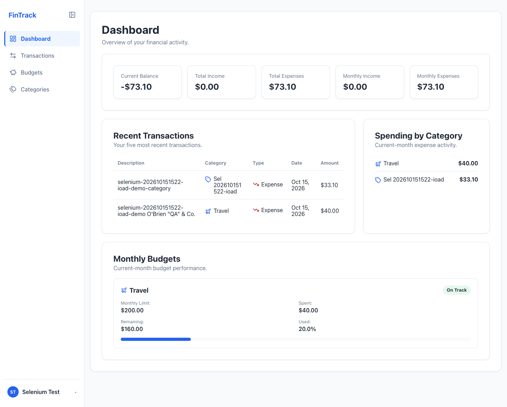
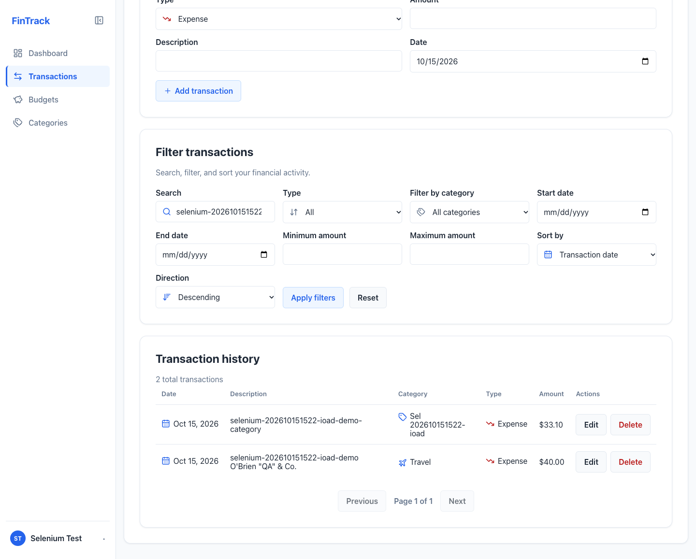
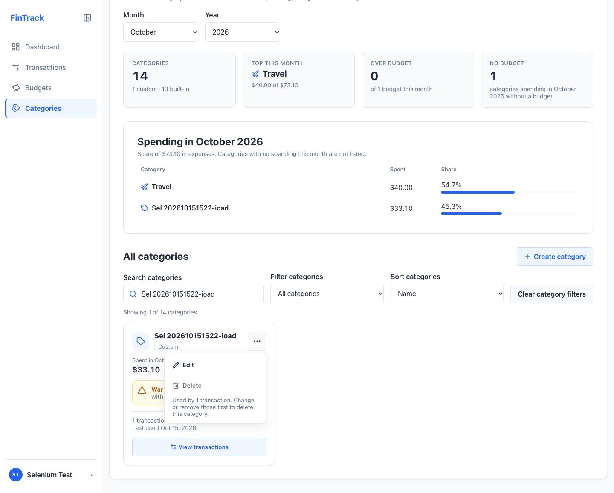
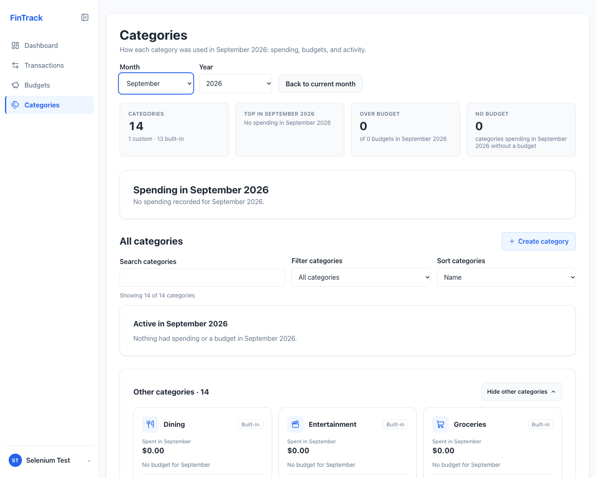
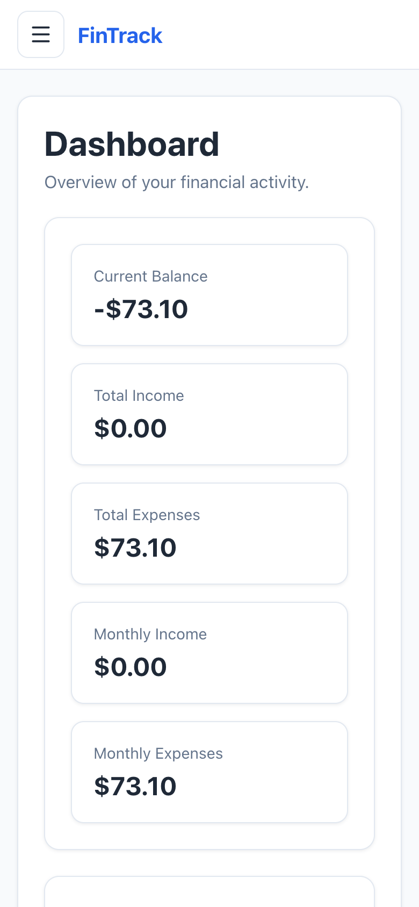
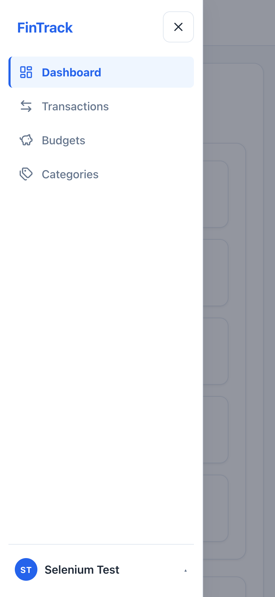
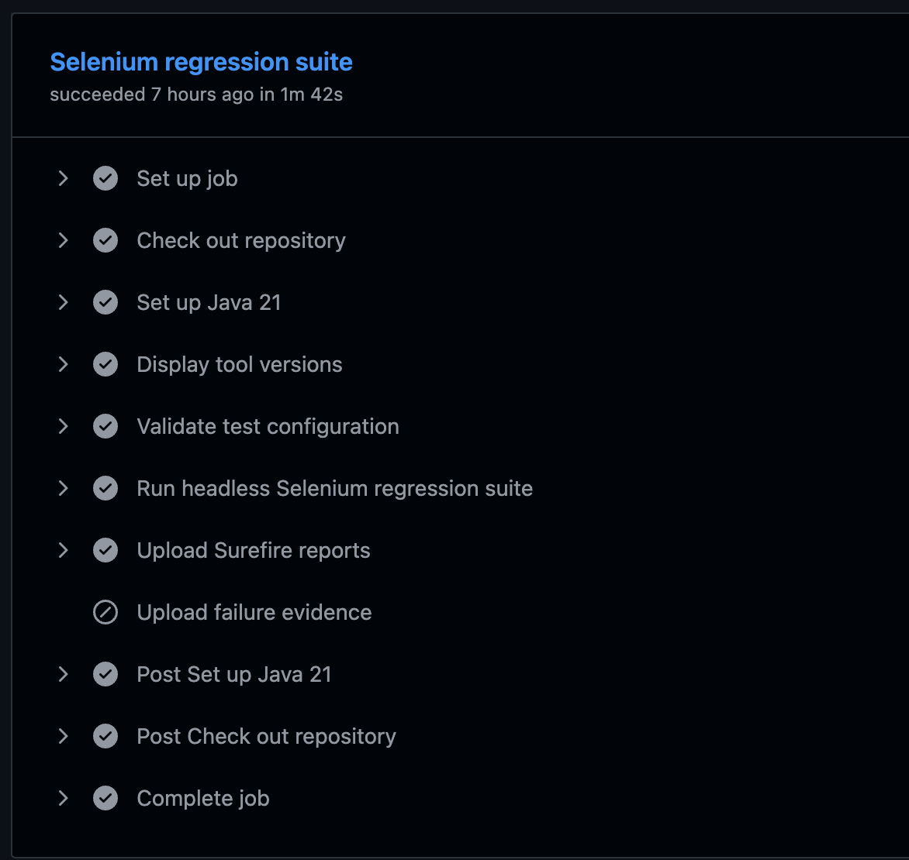
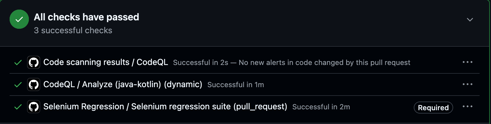

# FinTrack Selenium Automation Suite


[](https://github.com/garrib10/fintrack-selenium-automation/actions/workflows/selenium-regression.yml)


A standalone Selenium end-to-end suite for the deployed FinTrack personal finance application, refreshed for FinTrack v1.4.0.

> **Separate project:** FinTrack is the application under test. This repository contains only the external Selenium suite, not the FinTrack source code.

- [FinTrack application repository](https://github.com/garrib10/finance-operations-dashboard)
- [Deployed FinTrack application](https://finance-operations-dashboard.vercel.app/)

## Portfolio Story

> I built FinTrack as a full-stack application and then created a separate automated regression suite that validates critical user workflows against the deployed application.

## Tech Stack

| Area                   | Technologies                                         |
| ---------------------- | ---------------------------------------------------- |
| Language               | Java 21                                              |
| UI automation          | Selenium WebDriver 4.49.0                            |
| Test framework         | JUnit 5.14.4                                         |
| Build                  | Maven 3.9 or later                                   |
| Browser                | Google Chrome, headed or headless, fixed to `en-US`  |
| Driver management      | Selenium Manager                                     |
| Test architecture      | Page Object Model with application-shell components  |
| Reporting              | Surefire reports and automatic failure evidence      |
| Configuration          | Environment variables and a `.env` template          |
| Continuous integration | GitHub Actions                                       |

## What the Suite Covers

Every browser test class is tagged either `read-only` (never changes application data) or `mutating` (creates and deletes its own records). A unit test enforces this so CI can rely on it.

| Test class                       | Journey                                                                                                     | Data      | Tags                                    |
| -------------------------------- | ----------------------------------------------------------------------------------------------------------- | --------- | --------------------------------------- |
| `FinTrackSmokeTest`              | The deployed Login page loads                                                                               | Read-only | `smoke`                                 |
| `AuthenticationTest`             | Login, refresh, account-menu logout, protected-route redirect and return; invalid credentials               | Read-only | `smoke`, `authentication`               |
| `ProtectedRouteTest`             | Signed-out visits to `/`, `/transactions`, `/budgets`, `/categories` redirect to Login                      | Read-only | `smoke`, `authentication`               |
| `DashboardTest`                  | Dashboard loads; balance equals income minus expenses                                                       | Read-only | `smoke`, `dashboard`                    |
| `RegistrationTest`               | Registering an existing email is rejected                                                                   | Read-only | `authentication`                        |
| `TransactionTest`                | Create, edit and delete one transaction with special characters                                             | Mutating  | `transactions`                          |
| `TransactionFilterTest`          | Search, Income filter, and Reset against two run-owned records                                              | Mutating  | `transactions`                          |
| `BudgetTest`                     | Create, edit and delete a budget in the reserved CRUD month                                                 | Mutating  | `budgets`                               |
| `BudgetDashboardIntegrationTest` | A current-month expense moves Dashboard totals and budget progress                                          | Mutating  | `budgets`, `dashboard`, `integration`   |
| `CustomCategoryTest`             | Inline custom category, in-use delete protection, Categories-to-Transactions link, reload, deletion         | Mutating  | `categories`, `transactions`            |
| `BudgetValidationTest`           | The server rejects a duplicate budget for the same month                                                    | Mutating  | `staging-only` (excluded by default)    |

**Optional scenarios** are excluded from every default and CI run. They are run by name when wanted:

| Test class               | Journey                                                                                                 | Data      | Tags and opt-in                                             |
| ------------------------ | ------------------------------------------------------------------------------------------------------- | --------- | ----------------------------------------------------------- |
| `CategoriesHistoryTest`  | Show an earlier reporting month on Categories, then Back to current month                               | Read-only | `extended`                                                  |
| `MobileNavigationTest`   | At 390×844: open the drawer, navigate, open the account menu inside it, log out                         | Read-only | `extended`                                                  |
| `AccountPreferencesTest` | Change "Transactions per page", reload, and confirm it persisted; cleanup restores the original value   | Mutating  | `extended`                                                  |
| `ProfilePhotoTest`       | Upload a runtime-generated PNG, check both avatars, reload, remove it, and check the initials fallback  | Mutating  | `profile-photo`, plus `FINTRACK_ENABLE_PROFILE_PHOTO=true`  |
| `MaintenanceSweepTest`   | Delete records left by interrupted runs (see below)                                                     | Mutating  | `maintenance`, plus `FINTRACK_RUN_MAINTENANCE=true`         |

Browser-free `unit` tests cover configuration parsing, staging access, run IDs and ownership patterns, the cleanup registry, XPath escaping, displayed-value parsing, the image fixture, and the tag policy.

### Smoke versus regression

| Selection                    | Command                                                                                   | Contents (approximate, as of this refresh)        |
| ---------------------------- | ----------------------------------------------------------------------------------------- | ------------------------------------------------- |
| Smoke (read-only)            | `mvn test -Dgroups='smoke\|unit' -DexcludedGroups='staging-only,maintenance,profile-photo,mutating'` | About 8 browser executions plus the unit tests |
| Default regression           | `mvn test`                                                                                | About 14 browser executions plus the unit tests   |
| Staging-only duplicate check | `mvn test -Dtest=BudgetValidationTest -DexcludedGroups=none` (staging or local only)      | 1 browser execution                               |
| Optional scenarios           | `mvn test -Dtest=<OptionalClass> -DexcludedGroups=none`                                   | 1 browser execution per class                     |

`pom.xml` excludes `staging-only`, `maintenance`, `profile-photo` and `extended` from every run unless `-DexcludedGroups` overrides it. Always pair `-DexcludedGroups=none` with `-Dtest`, so it only brings in the class you name; the profile-photo and maintenance tests also skip themselves unless their opt-in variable is `true`. Selection never depends on the `regression` tag. Counts change as coverage changes; the Surefire reports for a run are the source of truth.

## Environments and Safety

| Category                   | Scenarios                                                                       | Where it may run                                   |
| -------------------------- | ------------------------------------------------------------------------------- | -------------------------------------------------- |
| Production-safe            | Everything tagged `read-only`                                                   | Production, staging, local                         |
| Dedicated account required | Everything tagged `mutating` except staging-only                                | Staging preferred; production only with approval   |
| Staging or local only      | `BudgetValidationTest`; successful registration (not automated)                 | Staging, local                                     |
| Optional, opt-in           | `AccountPreferencesTest`, `ProfilePhotoTest` (staging preferred), `MaintenanceSweepTest` | Dedicated account; run manually        |
| Manual only                | Password change, session-restoration failure, token expiry and cross-tab        | Not automated                                      |

Safety rules built into the suite:

- `FINTRACK_TARGET_ENV` must be set to `production`, `staging` or `local`. There is no default, so production is never selected by accident.
- The base URL must agree with the target: `local` must be localhost, `staging` cannot be the production host, and URLs with credentials, query strings or fragments are rejected. Errors name the variable, never its value.
- Only the target environment and host are logged. Credentials, tokens and staging-access secrets are never printed.
- Staging and production use different automation accounts (`FINTRACK_STAGING_*` and `FINTRACK_TEST_*`), with no fallback between them.
- Tests run serially. The suite shares one automation account per environment, so parallel execution would need one account per worker.
- `BudgetValidationTest` also skips itself if pointed at production.

## Configuration

Copy the template and fill it in. The real `.env` is excluded from Git.

```bash
cp .env.example .env
set -a; source .env; set +a
```

| Variable                                               | Required                         | Purpose                                                                 |
| ------------------------------------------------------ | -------------------------------- | ----------------------------------------------------------------------- |
| `FINTRACK_TARGET_ENV`                                  | Always                           | `production`, `staging` or `local`                                      |
| `FINTRACK_BASE_URL`                                    | Staging and local                | Frontend URL; production defaults to the deployed URL                   |
| `FINTRACK_TEST_EMAIL` / `FINTRACK_TEST_PASSWORD`       | Production and local             | Dedicated automation account                                            |
| `FINTRACK_STAGING_EMAIL` / `FINTRACK_STAGING_PASSWORD` | Staging                          | Separate staging automation account                                     |
| `FINTRACK_VERCEL_BYPASS_SECRET`                        | Protected staging (preferred)    | Vercel Protection Bypass for Automation secret                          |
| `FINTRACK_VERCEL_SHARE_TOKEN`                          | Protected staging (alternative)  | A Vercel share link or its `_vercel_share` token; may expire            |
| `FINTRACK_TEST_BUDGET_CATEGORY`                        | Mutating budget tests            | Built-in category reserved for automation budgets (`Travel`)            |
| `FINTRACK_HEADLESS` or `-Dheadless=true`               | Optional                         | Headless Chrome at 1440×1000; otherwise a maximized window              |
| `FINTRACK_ENABLE_PROFILE_PHOTO`                        | Optional                         | `true` to run `ProfilePhotoTest` (see below)                            |
| `FINTRACK_RUN_MAINTENANCE`                             | Optional                         | `true` to run `MaintenanceSweepTest` (see below)                        |

Staging access tokens are refused for any target other than staging. The browser uses the token once to obtain Vercel's access cookie, then leaves that URL, so the token never appears in later URLs, screenshots or page sources.

## Test Data and Cleanup

- **Run-specific names.** Each JVM run has one ID such as `202610151530-k3x9`. Transactions are named `selenium-<runId>-<scenario>` and custom categories `Sel <runId>`, so cleanup only ever touches records the current run created.
- **Cleanup registry.** Tests register cleanup just before saving each record. Cleanup runs after failure evidence is captured and before the browser quits. Order: transactions, then budgets, then categories, newest first within each. Each step reopens its page, runs independently, and treats an already-missing record as cleaned. A failure is reported without hiding the test's own failure.
- **Renames and deletions.** A renamed transaction is tracked under both names until the rename is confirmed. A record the test deleted itself has its cleanup cancelled.
- **Account settings.** A changed preference is restored to the value recorded before the test. The profile photo is removed only if the test uploaded it; a test that finds an existing photo stops instead.
- **Built-in categories** are never edited or deleted.

### Travel budget reservations

All automation budgets use the reserved category (`FINTRACK_TEST_BUDGET_CATEGORY`, `Travel`) in fixed months:

| Month            | Used by                                      |
| ---------------- | -------------------------------------------- |
| Current month    | `BudgetDashboardIntegrationTest`             |
| Next month       | `BudgetTest`                                 |
| Month after next | `BudgetValidationTest` (staging only)        |

A budget cannot carry the run ID, so each budget test first checks that its month has no Travel budget. If one exists, the test fails and leaves it untouched: remove it by hand and rerun. Avoid creating Travel budgets in these months on the automation account.

### Optional profile photo

`ProfilePhotoTest` uploads a photo, checks the settings and account-menu avatars, reloads, removes it through the "Remove your profile photo?" confirmation, and checks that initials return. It is tagged `profile-photo` (excluded by default), skips unless `FINTRACK_ENABLE_PROFILE_PHOTO=true`, and is best run on staging, which has its own Cloudinary configuration.

- The image is generated at runtime: a 64×64 solid-color PNG under 1 KB, written to a temporary directory with no text or EXIF metadata. The repository holds no binary fixtures or personal images.
- Once enabled, a missing upload control or a server error (for example photos disabled on the target) fails the test instead of skipping it.
- The automation account must start without a photo. If it already has one, the test stops and leaves it in place.

### Maintenance sweep

`MaintenanceSweepTest` cleans up after interrupted runs. It is tagged `maintenance` (excluded by default) and skips unless `FINTRACK_RUN_MAINTENANCE=true`:

```bash
FINTRACK_RUN_MAINTENANCE=true mvn test -Dtest=MaintenanceSweepTest -DexcludedGroups=none
```

- It deletes only transactions named `selenium-<runId>-…` (or the v1.0.0 format `selenium-…-<UUID>`), then categories named exactly `Sel <runId>`.
- Travel budgets in the reserved months are reported, never deleted, because a budget cannot carry a run ID.
- Built-in categories and anything else are never touched. Run it only when no other suite run is in progress.

## Running the Tests Locally

Prerequisites: Java 21, Maven 3.9 or later, Google Chrome.

```bash
set -a; source .env; set +a

# Read-only smoke coverage
mvn test -Dgroups='smoke|unit' \
  -DexcludedGroups='staging-only,maintenance,profile-photo,mutating'

# Full default regression (creates and deletes test data)
mvn clean test

# Headless
mvn clean test -Dheadless=true

# One class
mvn test -Dtest=TransactionTest

# Browser-free unit tests only
mvn test -Dgroups=unit

# Staging-only duplicate-budget check
FINTRACK_TARGET_ENV=staging mvn test -Dtest=BudgetValidationTest -DexcludedGroups=none
```

Before running anything tagged `mutating` against production, confirm the target and the dedicated account.

## Continuous Integration

`.github/workflows/selenium-regression.yml` runs the job **Selenium regression suite**, which is the required status check for pull requests into `main`.

| Trigger                    | Suite                         | Target                          |
| -------------------------- | ----------------------------- | ------------------------------- |
| Pull request into `main`   | Smoke (read-only)             | Production                      |
| Push to `main`             | Smoke (read-only)             | Production                      |
| Manual (`workflow_dispatch`) | Smoke or regression (chosen) | Staging (default) or production |

- Automatic runs never change application data. There is no scheduled run.
- A manual production regression also requires typing `mutate-production` in the confirmation input; otherwise the job stops before testing.
- One concurrency group, `fintrack-automation-account`, serializes every run, and runs in progress are never cancelled, since cancelling would skip cleanup.
- The FinTrack health endpoint (`<base URL>/api/health`) is checked with retries before Selenium starts, which also absorbs backend cold starts.
- The job logs only the selected suite, target and host.
- Surefire reports are always uploaded; screenshots, page sources and failure details are uploaded when a run fails. Both are kept for 7 days.
- Pull requests from forks receive no secrets, so the configuration check fails before any test runs.

Repository configuration:

| Name                            | Kind     | Used for                     |
| ------------------------------- | -------- | ---------------------------- |
| `FINTRACK_BASE_URL`             | Variable | Production frontend URL      |
| `FINTRACK_STAGING_BASE_URL`     | Variable | Staging frontend URL         |
| `FINTRACK_TEST_BUDGET_CATEGORY` | Variable | `Travel`                     |
| `FINTRACK_ALLOW_REGISTRATION`   | Variable | `false`                      |
| `FINTRACK_TEST_EMAIL` / `FINTRACK_TEST_PASSWORD`       | Secret | Production account |
| `FINTRACK_STAGING_EMAIL` / `FINTRACK_STAGING_PASSWORD` | Secret | Staging account    |
| `FINTRACK_VERCEL_BYPASS_SECRET` | Secret   | Protected staging access     |

## Test Evidence

When a browser test fails, `FailureEvidenceExtension` writes a screenshot, the page source, and the URL with the stack trace to `target/test-artifacts/<TestClass>/` before cleanup runs, so the evidence shows the failure rather than the cleaned-up page.

Surefire reports are written to `target/surefire-reports`. Both directories are generated, excluded from Git, and removed by `mvn clean`.

### Screenshots from the FinTrack v1.4.0 refresh

Captured on staging with temporary, run-owned data that was deleted afterwards.

| Budget progress on the Dashboard | Special characters in transaction history |
| --- | --- |
|  |  |

| Custom category delete blocked while in use | Earlier reporting month on Categories |
| --- | --- |
|  |  |

| Mobile Dashboard, 390×844 | Mobile navigation drawer |
| --- | --- |
|  |  |





## Project Structure

```text
src/test/java/dev/portfolio/fintrack/
|-- components/   AppShell (sidebar and mobile drawer), AccountMenu
|-- config/       TestConfig, TargetEnvironment, StagingAccess
|-- core/         BaseTest, AuthenticatedTest, DriverFactory,
|                 CleanupRegistry, FailureEvidenceExtension
|-- data/         TestData (run IDs and record names), ImageFixtures
|-- pages/        BasePage, Login, Register, Dashboard, Transactions,
|                 Budgets, Categories, AccountSettings, DeletionResult
`-- tests/        Browser journeys and the tag-policy unit test
```

## Automation Design

- **Page readiness.** Pages wait for lazy loading ("Loading page…", "Loading dashboard...", "Loading budgets for …") to finish and for the expected visible `h1`, not just a URL change.
- **Responsive duplicates.** FinTrack renders navigation in the sidebar and in a mobile drawer. Links are found only in the visible copy, by accessible name. The mobile test emulates a 390×844 viewport through Chrome's device metrics.
- **Status banners.** Success messages close after about three seconds; they are captured with fast polling and never waited on to close.
- **Native confirmations** are accepted explicitly and their exact text is asserted. An abandoned dialog is dismissed, never accepted.
- **Selectors.** Stable IDs and `data-testid` attributes first, then accessible names and scoped XPath. One shared helper escapes text containing quotes.
- **Waits.** Explicit waits only: no fixed sleeps and no test retries.
- **Assertions** live in test classes; page objects return state.

## Current Status

The suite has been refreshed for FinTrack v1.4.0: current page objects and application shell, consolidated authentication and transaction journeys, budget and custom-category coverage, run-specific test data with registry cleanup, explicit target selection, and read-only automatic CI.

Optional scenarios cover historical Categories, mobile navigation, account preferences, the profile-photo round trip and a maintenance sweep; they never run by default.
